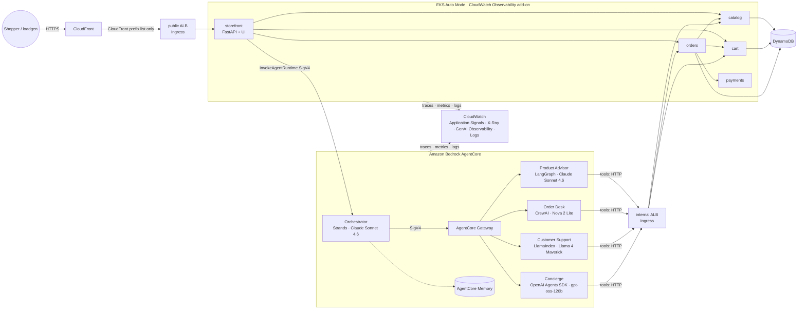

# ⚡ NeonByte Electronics — an AWS observability demo

NeonByte is an electronics web store built to **demonstrate end-to-end observability on AWS** —
the same idea as the [One Observability Demo](https://github.com/aws-samples/one-observability-demo)
(pet adoption), re-imagined as an e-commerce site with a **multi-agent AI shopping assistant**.

* **5 Python microservices** (storefront, catalog, cart, orders, payments) on **Amazon EKS Auto Mode** (Graviton),
  instrumented with zero code by the **amazon-cloudwatch-observability add-on**. A pod annotation makes
  its operator inject the ADOT Python auto-instrumentation, which feeds **Application Signals**, X-Ray traces,
  **Container Insights** and JSON logs with trace IDs (via Fluent Bit).
* **5 AI agents** in five frameworks, on **Amazon Bedrock AgentCore Runtime**, talking to each other through an
  **AgentCore Gateway** (SigV4). They use **AgentCore Memory** and an **Amazon Bedrock Guardrail**, and every LLM and tool call is
  traced in **CloudWatch GenAI Observability**.
* **One CloudFormation template** deploys everything — it even builds the container images from source.
* A **traffic generator** simulates shoppers (and assistant chats), locally or as a Kubernetes deployment.
* **Fault injection** knobs (latency, errors, card declines) flip at runtime via SSM — no redeploy.

## Architecture



### The agents

Same frameworks, models and Bedrock access as the reference Waggle agents (`agents/neonbyte_agents/common/models.py`):

| Agent | Framework | Model (Bedrock) | Access path | Does |
| --- | --- | --- | --- | --- |
| `orchestrator_strands` ("Sparky") | Strands Agents | Claude Sonnet 4.6 | `BedrockModel` (boto3) + Guardrail | Routes each request; chains specialists |
| `product_advisor_langgraph` | LangGraph | Claude Sonnet 4.6 | `ChatBedrockConverse` + Guardrail | Recommends/compares products, buying guides |
| `order_desk_crewai` | CrewAI | Amazon Nova 2 Lite | CrewAI Bedrock LLM | Cart add/remove/view, checkout |
| `support_llamaindex` | LlamaIndex | Llama 4 Maverick | `BedrockConverse` | Order status, returns, warranty, troubleshooting |
| `concierge_openai` | OpenAI Agents SDK | gpt-oss-120b | `LitellmModel` → Bedrock | Tech Q&A, store info, small talk |

All auth is the standard AWS credential chain (**SigV4**) — no API keys anywhere. Agent-to-agent calls
use `AGENT_TRANSPORT`: `gateway` on AWS (SigV4 POST to `{gateway}/<target>/invocations`), `http` for
separate local processes/containers, `local` for one in-process Python run. The orchestrator emits a
CLIENT span with `aws.remote.service=NeonByte<Agent>.DEFAULT` for each delegation, so the Application
Signals map draws orchestrator → sub-agent edges (the same technique the reference uses).

### Telemetry, as in the reference

| Signal | EKS microservices | AgentCore agents |
| --- | --- | --- |
| Traces | `instrumentation.opentelemetry.io/inject-python` → operator-injected ADOT Python → CloudWatch agent DaemonSet → X-Ray / Transaction Search | ADOT `opentelemetry-instrument` with `AGENT_OBSERVABILITY_ENABLED=true` → X-Ray OTLP endpoint; runtime vended traces → X-Ray delivery |
| Metrics | Application Signals (latency/faults/errors per operation, environment `eks:neonbyte-eks/neonbyte`), Container Insights *enhanced* (EKS), ALB, DynamoDB, log metric filters (`NeonByte/OrdersPlaced`, `DeclinedPayments`) | `bedrock-agentcore` + GenAI Observability (sessions, tokens, latency), `AWS/Bedrock` per model |
| Logs | JSON container logs → Fluent Bit → `/aws/containerinsights/neonbyte-eks/application`, with `traceId` (X-Ray format) for log↔trace correlation | `/aws/bedrock-agentcore/runtimes/*` + vended `APPLICATION_LOGS` |
| Infra | VPC Flow Logs → `/neonbyte/vpc/flowlogs`; EKS control-plane logs (api, audit, authenticator); Container Insights node/pod metrics; CodeBuild logs | — |

The stack also enables **Application Signals discovery** and **X-Ray Transaction Search** and creates
the **NeonByte-&lt;region&gt; dashboard** plus two alarms.

## Repository layout

```text
services/                  5 FastAPI microservices (one shared Dockerfile, SERVICE build-arg)
  common/                  config (env → SSM), DynamoDB/in-memory store, chaos middleware, JSON logs
  storefront/              web UI (Jinja + vanilla JS, Sparky chat widget) + JSON API
  catalog/ cart/ orders/ payments/
agents/
  neonbyte_agents/         one package per agent: agent.py + server.py (AgentCore entrypoint)
    common/                config, models (single source of truth), memory, store client, AgentCore server
    knowledge/             buying guides, policies, troubleshooting (keyword retrieval)
  deploy/                  Dockerfile (AGENT build-arg, ARM64) + pinned-per-agent requirements
traffic/loadgen.py         traffic generator (local CLI and EKS deployment)
deploy/cloudformation/     neonbyte.yaml — the whole application in one template
deploy/k8s/render.py       renders the Kubernetes manifests (Deployments, Services, Ingresses, NodePool)
deploy/scripts/            deploy.sh · destroy.sh · build-images.sh · k8s-apply.sh · chaos.sh
local/run-local.sh         run everything as local processes
docker-compose*.yml        run everything in containers (Jaeger, or CloudWatch for agents)
tests/                     in-process end-to-end tests + template checks
```

## Run locally

Prerequisites: Python 3.12 or 3.13 (CrewAI does not support 3.14 yet). For the agents, you also need AWS credentials
with **Amazon Bedrock model access** in your region (see [Bedrock model access](#bedrock-model-access)).

### Option A — local processes (fastest)

```bash
make venv                       # .venv with services + agents + test deps
export AWS_PROFILE=my-profile AWS_REGION=us-east-1   # credentials for Bedrock (agents only)
make run-local                  # 4 services + storefront + 5 agents, all on 127.0.0.1
open http://127.0.0.1:8080      # shop, and click "Ask Sparky"
make load                       # in another terminal: simulated shoppers
```

* `make run-local-noagents` runs only the store (no AWS needed). Data is in memory.
* `local/run-local.sh --single-agent` runs the orchestrator with `AGENT_TRANSPORT=local` (sub-agents
  in-process) — handy for stepping through agent code in a debugger.
* Ports: storefront 8080, catalog 8081, cart 8082, orders 8083, payments 8084, orchestrator 8090,
  advisor 8091, orderdesk 8092, support 8093, concierge 8094. Logs in `local/logs/`.
* Run a single agent on its own: `cd agents && PORT=8091 python -m neonbyte_agents.product_advisor_langgraph.server`,
  then `curl -s 127.0.0.1:8091/invocations -d '{"prompt":"best earbuds under $300?"}'`.

### Option B — containers with tracing (docker compose / finch compose)

```bash
eval "$(aws configure export-credentials --format env)"   # or AWS_PROFILE with ~/.aws mounted
docker compose up --build                       # storefront http://127.0.0.1:8080, Jaeger http://127.0.0.1:16686
docker compose --profile load up --build        # + traffic generator
```

The containers get the same ADOT Python auto-instrumentation the EKS operator injects: an init container
fills a shared volume and `PYTHONPATH` activates it. Locally they export OTLP to Jaeger instead of the CloudWatch agent.

**Send local agent telemetry to CloudWatch:** with Transaction Search enabled in the account (the stack
does it) and the log group `/neonbyte/local/agents` present, run
`docker compose -f docker-compose.yml -f docker-compose.cloudwatch.yml up --build`. The agents then
appear in CloudWatch **GenAI Observability** as `NeonByte*-local` — the documented ADOT setup for agents
hosted outside AgentCore Runtime.

## Deploy to your AWS account (CloudFormation)

Prerequisites: AWS CLI v2, credentials with permission to create the resources below (an admin role in a
sandbox/workshop account), `zip`, and **Bedrock model access** for the four models.

```bash
export AWS_REGION=us-east-1          # a region with AgentCore Runtime + the models (us-east-1 / us-west-2 tested)
deploy/scripts/deploy.sh             # ≈ 25-35 min on first deploy
```

`deploy.sh` zips this checkout into a private S3 bucket (`neonbyte-artifacts-<account>-<region>`,
Block Public Access on), then runs `aws cloudformation deploy`. Inside the stack:

1. A custom resource starts a **CodeBuild (arm64)** build that builds and pushes all 11 images, then signals CloudFormation.
2. CloudFormation creates the **EKS Auto Mode** cluster, the CloudWatch Observability add-on, a Pod Identity
   association, the AgentCore runtimes, the Gateway and the Memory.
3. A second custom resource runs CodeBuild again to apply the manifests (`deploy/k8s/render.py`) and wait for the
   two ALBs the EKS load balancer controller creates. It returns their DNS names to the stack, which then
   creates CloudFront in front of the public ALB and publishes the internal ALB URL to SSM for the agents.

The outputs print the **StorefrontUrl**, the `kubectl` config command, the dashboard and console links.
Whoever creates the stack gets cluster-admin, so `kubectl get pods -n neonbyte` works right away.

Other ways to launch:

* **Console / StackSets / workshops:** upload `deploy/cloudformation/neonbyte.yaml` (> 51 KB, so via
  S3) and set either `SourceS3Uri` (a zip of this repo) or `SourceRepoUrl` (a public git URL of
  this repo, e.g. after you push it to GitHub). Acknowledge IAM + `CAPABILITY_AUTO_EXPAND` (the template
  uses the `AWS::LanguageExtensions` transform).
* **Update code:** re-run `deploy.sh` — a new `ImageTag` rebuilds images and rolls services and agents.
  `deploy.sh --no-rebuild` changes infrastructure/parameters only.
* **Tear down:** `deploy/scripts/destroy.sh` (add `--bucket` to also remove the artifacts bucket).

Key parameters (`--param Key=Value` with `deploy.sh`):

| Parameter | Default | Notes |
| --- | --- | --- |
| `LoadGenDesiredCount` / `LoadGenUsers` | 1 / 5 | traffic generator pods × simulated shoppers (0 = off) |
| `LoadGenChatProbability` | 0.05 | chance per journey of an assistant chat — **the main Bedrock cost driver** |
| `ClaudeModelId`, `NovaLiteModelId`, `LlamaModelId`, `GptOssModelId` | `us.` inference profiles | use `eu.`/`apac.` profiles outside the US |
| `AvailabilityZoneId1/2` | per-region map | AZ **IDs** supported by AgentCore VPC mode (e.g. `use1-az1`, `use1-az2`) |
| `EnableTransactionSearch` / `EnableApplicationSignalsDiscovery` | true | set **false** if already enabled in the account/region |
| `EnableGuardrail` | true | Bedrock Guardrail on the Claude-backed agents |
| `ServiceDesiredCount` | 1 | pod replicas per microservice |
| `KubernetesVersion` | 1.36 | EKS version |

> One NeonByte stack per account/region: resource names (runtimes, tables, `/neonbyte/*` parameters) are fixed.

### Bedrock model access

Enable these in the Bedrock console (Model access) for your region, with the cross-region inference
profiles for the `us.` ids: **Claude Sonnet 4.6** (Anthropic requires a one-time use-case form),
**Amazon Nova 2 Lite**, **Llama 4 Maverick 17B Instruct**, **gpt-oss-120b**. The agents' IAM role
includes the Marketplace subscribe permissions that some first invocations need.

### Security notes

* The storefront is a **public demo shop** for anonymous visitors (like any retail site), served over
  HTTPS by CloudFront. The public ALB accepts traffic **only from CloudFront's origin-facing prefix list**.
  Pods and agents run in private subnets. Pods accept port 8080 only from the two ALBs (and from each other inside the cluster),
  and the internal ALB accepts traffic only from the agents' security group.
* The EKS API endpoint is public and IAM-authenticated (SigV4 + access entries), so CodeBuild and your laptop can
  run `kubectl`. Only the stack creator and the CodeBuild role have access entries.
* Anyone with the URL can chat with the assistant, which invokes Bedrock models in your account. Delete the
  stack when you are done, and keep `LoadGenChatProbability` low. To restrict access, put the distribution
  behind AWS WAF (IP allow list) or Cognito, or delete the CloudFront distribution and reach the ALB through
  a private path.
* Agent-to-agent calls go through an AgentCore Gateway with **AWS_IAM (SigV4)** inbound auth.
  The storefront invokes the orchestrator with `bedrock-agentcore:InvokeAgentRuntime`, scoped to
  `runtime/NeonByteOrchestrator*`.
* Locally, every process binds to `127.0.0.1`. Docker compose publishes only the storefront and the Jaeger UI,
  and only on loopback.
* This is a demo: there is no real login (pick a shopper from the header), payments are simulated, and one IAM role
  is shared by the five services (one Pod Identity service account).

## Observability walkthrough (things to try)

1. **Service map:** CloudWatch → Application Signals → *Service Map*. You'll see shopper → storefront →
   catalog/cart/orders → payments → DynamoDB, plus storefront → `NeonByteOrchestrator` → sub-agents.
2. **Kubernetes view:** CloudWatch → Container Insights → *neonbyte-eks* (pods, nodes, namespace), or
   `kubectl -n neonbyte get pods,ingress` after running the `KubectlConfigCommand` output.
3. **A chat, end to end:** ask Sparky *"Recommend noise-cancelling earbuds and add them to my cart"*.
   In **GenAI Observability → Bedrock AgentCore**, open the session. The trace shows the Strands
   orchestrator, two delegations through the Gateway, the LangGraph and CrewAI spans, the Bedrock model calls (with tokens) and
   the HTTP tool calls into catalog/cart, all in one trace.
4. **Inject latency:** `deploy/scripts/chaos.sh latency payments 1500`. Checkout p99 jumps on the
   dashboard and in Application Signals (`orders` → `payments` edge). Reset with `chaos.sh reset`.
5. **Inject faults:** `chaos.sh errors catalog 0.2` — storefront 5xx alarm fires; X-Ray shows the faulting
   segment; the dashboard log widget lists the `chaos: injected failure` lines with their `traceId`.
6. **Business errors:** `chaos.sh declines 0.5` — 402s (errors, not faults) and the
   `neonbyte-payment-declines` alarm, driven by a log metric filter.
7. **Logs ↔ traces:** in Logs Insights on `/aws/containerinsights/neonbyte-eks/application`, query
   `fields @timestamp, kubernetes.container_name, @message | filter @message like /order placed/`. Paste a
   `traceId` into Transaction Search.
8. **Agent quality and cost:** compare per-model `InputTokenCount` and latency on the dashboard. Swap the Order Desk
   model with `--param NovaLiteModelId=...` and compare.

## Tests

```bash
make test        # services end-to-end in-process (checkout saga, declines, returns) + template checks
make lint-cfn    # cfn-lint for us-east-1 and us-west-2
```

## Troubleshooting

* **Stack waits on `ContainerImages` or `K8sApp`:** open the `neonbyte-image-build` CodeBuild project logs
  (one build per step). If a step fails, the stack rolls back with the build ID in the reason.
* **Pods Pending:** `kubectl get nodeclaims` — Auto Mode is provisioning Graviton nodes for the `neonbyte-arm64` NodePool.
* **Slow delete or `DELETE_FAILED` on subnets:** AgentCore Runtime's VPC network interfaces are released
  asynchronously (can take up to about an hour). Retry the delete once they are gone.
* **`TransactionSearch` or `ApplicationSignalsDiscovery` fails:** it's already configured in the account.
  Redeploy with `--param EnableTransactionSearch=false` and/or `EnableApplicationSignalsDiscovery=false`.
* **Runtime creation fails with a subnet/AZ error:** pass AgentCore-supported AZ IDs via
  `AvailabilityZoneId1/2`.
* **Assistant replies with an AccessDenied / model error:** the model isn't enabled in Bedrock model access for that region.
